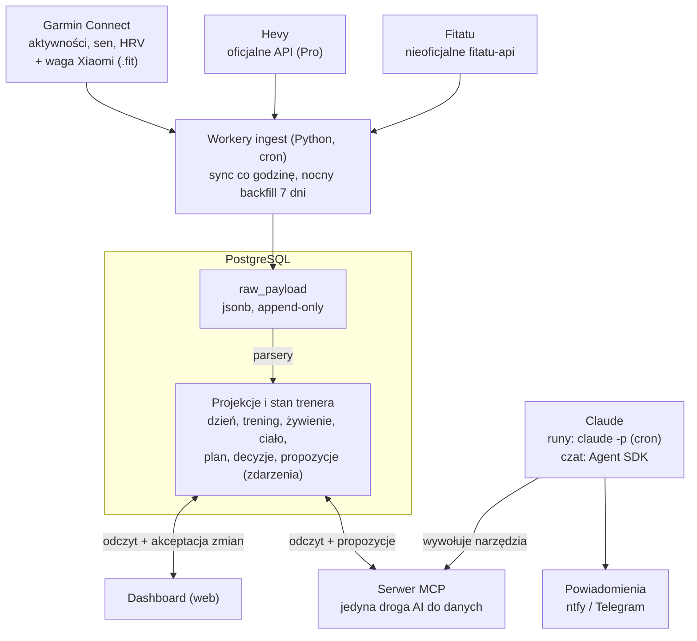

# Sportowy dashboard + AI trener — design

2026-10-25 · Patryk

## Cel i zakres

System zbiera dane z Garmina, Hevy, Fitatu i wagi Xiaomi w jednej bazie, pokazuje je na dashboardzie i daje AI trenera, który codziennie podsumowuje dzień, pilnuje planu długoterminowego i układa żywienie pod trening.

- **Dashboard** to główny interfejs: liczby, trendy, plan i propozycje trenera do akceptacji.
- **AI trener** działa w dwóch rytmach (dzienny i tygodniowy) oraz na żądanie przez czat w aplikacji Claude.
- **Kontekst sportowy na start:** półmaraton poniżej 1:40, maraton 14.03.2027 (w rozważaniu) z celem 4:00, siłownia w układzie Push/Pull/Legs.
- **Poza zakresem:** diagnoza medyczna, zapis do aplikacji źródłowych, obsługa innych użytkowników niż właściciel.

## Źródła danych i integracje

Tylko Hevy ma oficjalne API; Garmin i Fitatu idą przez nieoficjalne biblioteki, a waga trafia do Garmina, więc integracji jest trzy, nie cztery.

| Źródło | Metoda | Dane | Ryzyko | Sync |
| --- | --- | --- | --- | --- |
| [Garmin Connect](https://github.com/cyberjunky/python-garminconnect) | python-garminconnect, nieoficjalne, OAuth jak aplikacja | aktywności, sen, HRV, tętno spoczynkowe, skład ciała z wagi | Garmin zmienia logowanie, biblioteka nadrabia z opóźnieniem | co godzinę + nocny backfill 7 dni (sen domyka się później) |
| [Hevy](https://docs.serval.com/sections/integrations/hevy) | oficjalne API v1, nagłówek api-key, wymaga Hevy Pro | treningi, serie, ćwiczenia, szablony | API we wczesnej wersji | co godzinę, przyrostowo przez zdarzenia zmian treningów |
| [Fitatu](https://pypi.org/project/fitatu-api/) | fitatu-api, nieoficjalne, reverse-engineered | posiłki, kcal, makro, woda | może się zepsuć bez ostrzeżenia; makra dzień po dniu wymagają Premium | 3 razy dziennie + nocny backfill 7 dni (posiłki dopisuje się z opóźnieniem) |
| [Waga Xiaomi](https://forums.garmin.com/apps-software/mobile-apps-web/f/garmin-connect-web/118678/xiaomi-mi-smart-scale-with-garmin-connect/1698565) | Mi Scale Exporter → Garmin jako plik .fit ze składem ciała | waga, % tłuszczu, masa mięśniowa, woda | zależy od telefonu i modelu wagi | razem z Garminem |

Fitatu w ingeście (`services/ingest/ingest/fitatu.py`, `fitatu-api` 0.6.0): na każdy dzień trzy surowe odpowiedzi — `diet_day` (`/diet-and-activity-plan/{user}/day/{date}`: posiłki z pozycjami, flaga zjedzone, kcal i makro), `settings` (`/users/{user}/settings-new/{date}`: cele kcal i makro, BMR/TMR) i `water`. Worker używa wyłącznie odczytów biblioteki (ma też metody zapisu: posiłki, produkty, waga — nie wolno ich wołać). Logowanie raz przez `ingest fitatu-login`; sesja z tokenami w wolumenie, biblioteka sama ją odświeża. Harmonogram: 10:15, 16:15, 22:15 po 2 dni + backfill 7 dni o 3:20.

Plan B dla Fitatu i wagi: Health Connect / Apple Zdrowie, z którymi Fitatu synchronizuje się w obie strony.

Otwarte pytanie: jaki telefon i model wagi — to rozstrzyga, czy Mi Scale Exporter zadziała.

## Architektura

Każda warstwa ma jedno zadanie: workery tylko zbierają, Postgres trzyma surowe dane i projekcje, a dashboard i trener czytają wyłącznie z projekcji.



Strzałki w obie strony oznaczają zapis do własnej bazy: dashboard zapisuje akceptacje zmian planu, serwer MCP notatki i propozycje trenera; źródeł dotykają tylko workery.

## Model danych

Surowe odpowiedzi API są jedynym źródłem prawdy; wszystko inne to projekcje, które można skasować i odbudować po zmianie parsera.

| Tabela | Klucz | Co trzyma |
| --- | --- | --- |
| raw_payload | source, endpoint, external_id, body_hash | surowy JSON z API, data, wersja parsera |
| day_summary | date | sen, HRV, tętno spoczynkowe, kroki, kcal spalone i zjedzone, waga |
| activity | source, external_id | biegi i inne aktywności: dystans, czas, tempo, tętno, strefy, obciążenie |
| strength_set | workout_id, exercise, set_no | ćwiczenie, partia mięśniowa, ciężar, powtórzenia, RPE |
| nutrition_day | date | kcal, białko, węgle, tłuszcz, posiłki |
| body_composition | measured_at | waga, % tłuszczu, masa mięśniowa, woda |
| athlete_profile | version | cele, ograniczenia, kontuzje, preferencje (markdown) |
| plan_event | stream_id, seq | zdarzenia planu: utworzenie, propozycja, akceptacja, odrzucenie |
| plan_session | date, slot | projekcja planu: sesja i cel żywieniowy dnia |
| coach_note | date, kind | podsumowania dzienne i tygodniowe, decyzje z uzasadnieniem |

Unikalność po `body_hash` czyni ponowny fetch idempotentnym, a zmieniona treść tego samego rekordu zostaje jako nowa wersja. Klucz jest `unique nulls not distinct` (Postgres 15+), bo bez tego wpisy bez `external_id` dublowałyby się przy każdym fetchu.

Obok `raw_payload` są dwie tabele techniczne ingestu: `sync_state` (kursor przyrostowy per źródło i endpoint, np. `since` dla zdarzeń Hevy) i `ingest_run` (każdy run ze statusem `ok | partial | error`, liczbą nowych payloadów i błędami). `ingest_run` jest podstawą bramki „2 tygodnie syncu bez ręcznych poprawek”.

Projekcje buduje kod w Go (`api project`), nie workery: Python tylko zbiera, a parsowanie i metryki są w jednym języku z serwerem MCP.

Każda projekcja to pełna przebudowa w jednej transakcji z najnowszej wersji każdego rekordu (`max(id)` per źródło, endpoint, `external_id`). `api serve` robi ją przy starcie i co `PROJECT_INTERVAL` (domyślnie 5 min), więc nowe runy ingestu trafiają na dashboard bez sprzężenia workerów z API. Payload, którego nie da się sparsować, jest pomijany i logowany, nie blokuje reszty. Trening usunięty w Hevy znika, gdy zdarzenie usunięcia jest nowsze niż ostatnia wersja treningu.

```sql
create table raw_payload (
  id          bigserial primary key,
  source      text not null,      -- garmin | hevy | fitatu
  endpoint    text not null,      -- np. sleep, activities, workouts
  external_id text,
  for_date    date,
  body        jsonb not null,
  body_hash   text not null,
  fetched_at  timestamptz not null default now(),
  unique (source, endpoint, external_id, body_hash)
);

create table plan_event (
  stream_id  uuid not null,       -- makrocykl
  seq        int  not null,
  type       text not null,       -- PlanCreated | PlanChangeProposed | PlanChangeAccepted | PlanChangeRejected
  payload    jsonb not null,
  actor      text not null,       -- user | coach
  created_at timestamptz not null default now(),
  primary key (stream_id, seq)
);
```

## Stan trenera

Trener nie pamięta niczego poza tym, co jest w bazie: profil, plan i dziennik decyzji to jego jedyna pamięć między runami.

- **Profil sportowca** — dokument markdown, edytowany ręcznie i wersjonowany: cele, dostępny czas, sprzęt, kontuzje, preferencje żywieniowe.
- **Hierarchia planu** — makrocykl (cel + data startu) → bloki (baza, budowa, szczyt, taper) → tydzień (kilometraż, sesje kluczowe, rozkład PPL) → sesja (typ, intensywność, cel) + cel żywieniowy dnia (kcal, białko, węgle wg typu dnia).
- **Dziennik decyzji** — każdy run zapisuje, co zalecił i dlaczego; kolejny dostaje 14 ostatnich wpisów, więc wie, czemu wczoraj coś zmienił.

Zmiana planu przechodzi zawsze tę samą drogę:

1. Trener wywołuje `propose_plan_change` → zdarzenie `PlanChangeProposed` z uzasadnieniem.
2. Walidatory w kodzie sprawdzają propozycję; odrzucona przez regułę nie trafia do kolejki, a trener dostaje powód.
3. Propozycja pojawia się w widoku Propozycje z diffem planu przed i po.
4. Ty akceptujesz albo odrzucasz z komentarzem → `PlanChangeAccepted` / `PlanChangeRejected`.
5. Projekcja `plan_session` przelicza się po akceptacji; komentarz z odrzucenia trafia do kontekstu trenera, żeby nie proponował tego samego.

## Metryki liczone w kodzie

Model dostaje gotowe agregaty i je interpretuje; sam niczego nie przelicza, więc nie myli się w arytmetyce i zużywa mniej tokenów.

| Metryka | Definicja | Źródło |
| --- | --- | --- |
| Obciążenie: ATL / CTL / TSB | ATL = średnia wykładnicza obciążenia z 7 dni, CTL = z 42 dni, TSB = CTL − ATL | Garmin (training load lub TRIMP z tętna) |
| Kilometraż tygodniowy | suma km biegu w tygodniu ISO i zmiana tydzień do tygodnia w % | Garmin |
| Długie wybieganie | najdłuższy bieg tygodnia vs plan | Garmin + plan |
| Objętość siłowa | serie robocze na partię mięśniową na tydzień; tonaż (ciężar × powtórzenia) na sesję | Hevy |
| Gotowość | HRV: średnia 7 dni vs linia bazowa 60 dni; tętno spoczynkowe; sen w godzinach | Garmin |
| Żywienie vs cel | kcal, białko w g/kg, węgle w g/kg vs cel dnia; odchylenie w % | Fitatu + plan |
| Waga | średnia krocząca 7 dni i jej zmiana tydzień do tygodnia | waga przez Garmina |
| Realizacja planu | % zaplanowanych sesji wykonanych w tygodniu | plan + Garmin + Hevy |

Pojedyncze ważenie i pojedynczy odczyt HRV są zbyt zaszumione, dlatego trener widzi tylko średnie i odchylenia od bazy.

Definicje w kodzie (`services/api/internal/metrics`, `internal/dashboard`), wartości startowe do strojenia:

| Metryka | Implementacja |
| --- | --- |
| ATL / CTL | średnie wykładnicze dziennej sumy `activityTrainingLoad` z Garmina, α = 1 − e^(−1/7) i 1 − e^(−1/42); historia 180 dni, dni bez aktywności = 0 |
| TSB dnia | CTL − ATL z **poprzedniego** dnia: forma „na rano”, dzisiejszy trening jej nie psuje |
| Forma (etykieta TSB) | ≥ 0 świeży, −10…0 neutralnie, −30…−10 zmęczony, < −30 przeciążony |
| HRV | średnia 7 dni (min. 3 noce) vs baza 60 dni (min. 14 nocy); „w normie” od 95% bazy, niżej „poniżej bazy” |
| Tętno spoczynkowe | dziś vs średnia 7 poprzednich dni |
| Waga | średnia 7 dni od 3 ważeń, zmiana vs 7 dni wcześniej (też od 3 ważeń) |
| Kilometraż | suma dystansu aktywności, których typ zawiera `running` (bieg, bieżnia, trail), w tygodniu ISO |
| Serie robocze | serie Hevy bez rozgrzewek i z powtórzeniami, po głównej partii z szablonu ćwiczenia; bez `cardio` |
| Status syncu | ostatni run źródła z `ingest_run`: `error`/`partial` wprost, `stale` bez udanego runu od 3 h |

## Rytmy AI

Run dzienny rano daje podsumowanie i decyzję na dziś; run tygodniowy w niedzielę koryguje plan na kolejny tydzień.

**Run dzienny** (6:30, po syncu snu):

1. Sync źródeł i przeliczenie projekcji.
2. Kod buduje kontekst: profil, sesja z planu na dziś, wczoraj vs plan, gotowość, żywienie wczoraj vs cel, trendy 7 dni, 14 ostatnich wpisów dziennika.
3. `claude -p` z podpiętym serwerem MCP; model może dopytać narzędziami o szczegóły.
4. Wyjście w ustalonym JSON-ie: podsumowanie, flagi, decyzja na dziś, cel żywieniowy, opcjonalnie propozycja zmiany planu.
5. Kod waliduje JSON, zapisuje `coach_note`, wysyła push.

**Run tygodniowy** (niedziela 20:00, mocniejszy model): plan vs wykonanie całego tygodnia, trend obciążenia i wagi, propozycja następnego tygodnia (sesje + cele żywieniowe) jako `PlanChangeProposed`.

Szkic promptu dziennego:

```text
Jesteś trenerem biegowo-siłowym i dietetykiem sportowym zawodnika.
Profil i cele: {profile}
Plan na dziś: {planned_session}; cel żywieniowy: {nutrition_target}
Wczoraj: {executed_vs_plan}
Gotowość: HRV {hrv_7d} vs baza {hrv_60d}, sen {sleep_h} h, RHR {rhr}
Trendy 7 dni: {trends}
Ostatnie decyzje: {coach_log_14d}

Zasady:
- Liczby bierz tylko z danych powyżej lub z narzędzi.
- Plan zmieniasz wyłącznie przez propose_plan_change, z uzasadnieniem.
- Brak danych: napisz, czego brakuje, nie zgaduj.
- Ból lub podejrzenie kontuzji: zalecenie konsultacji z fizjoterapeutą, bez diagnozy.
Zwróć JSON zgodny ze schematem daily_summary.
```

```json
{
  "summary": "max 5 zdań",
  "flags": [{ "level": "info|warn", "text": "..." }],
  "today": { "action": "keep|modify|rest", "session": "...", "why": "..." },
  "nutrition": { "kcal": 0, "protein_g": 0, "carbs_g": 0 },
  "proposal_id": null
}
```

## Narzędzia MCP

Serwer MCP jest jedyną drogą AI do danych: czyta projekcje i zapisuje tylko notatki oraz propozycje — nie ma narzędzia do akceptacji planu ani do zapisu w Garminie, Hevy czy Fitatu.

| Narzędzie | Typ | Co robi |
| --- | --- | --- |
| `get_day_summary(date)` | odczyt | sen, HRV, aktywności, żywienie i waga z jednego dnia |
| `get_trends(metric, from, to)` | odczyt | szereg dowolnej metryki z sekcji Metryki |
| `get_activities(from, to, type?)` | odczyt | lista aktywności z tempem, tętnem, obciążeniem |
| `get_strength_volume(from, to, group_by)` | odczyt | serie i tonaż per partia, ćwiczenie lub sesja |
| `get_nutrition(from, to)` | odczyt | kcal i makro per dzień vs cel |
| `get_supplements(from, to)` | odczyt | zestaw, reguły, odhaczenia i zapasy suplementów |
| `get_plan(from, to)` | odczyt | sesje i cele żywieniowe z projekcji planu |
| `get_profile()` | odczyt | aktualna wersja profilu sportowca |
| `get_coach_log(days)` | odczyt | ostatnie podsumowania i decyzje trenera |
| `save_coach_note(kind, date, content)` | zapis | podsumowanie albo decyzja do dziennika |
| `propose_plan_change(changes, rationale)` | propozycja | tworzy `PlanChangeProposed`, uruchamia walidatory, zwraca ich wynik |

Ten sam serwer obsługuje runy z crona i czat ad hoc w aplikacji Claude; w czacie warto wyłączyć `save_coach_note`, żeby luźne pytania nie zaśmiecały dziennika.

## Czat z trenerem (Agent SDK)

Czat w dashboardzie działa przez Claude Agent SDK zalogowany twoją subskrypcją i korzysta z tego samego serwera MCP co runy z crona, więc narzędzia i walidatory są wspólne dla obu.

1. UI wysyła wiadomość razem z kontekstem ekranu (np. widok Plan, tydzień 26.10–1.11) do API w Go.
2. API przekazuje ją do serwisu `coach-chat` w TypeScript (Agent SDK jest dostępny dla TypeScript i Pythona, nie dla Go) i streamuje odpowiedź do UI przez SSE.
3. `coach-chat` woła `query()` z `resume` = id sesji rozmowy, więc trener pamięta wątek; id sesji trzyma tabela `chat_session`.
4. Model sięga po dane wyłącznie przez serwer MCP. `propose_plan_change` z czatu tworzy zwykłą propozycję: UI pokazuje ją w rozmowie jako kartę z Akceptuj / Odrzuć, a ona trafia też do widoku Propozycje.

| Opcja `query()` | Wartość | Po co |
| --- | --- | --- |
| `mcpServers` | `forma`: HTTP, wewnętrzny URL + token w nagłówku | dostęp tylko do twoich danych |
| `strictMcpConfig` | `true` | ignoruje inne serwery MCP i connectory |
| `tools` | `[]` | żadnych wbudowanych narzędzi (Bash, Read, Write, Edit, WebFetch…): czat nie dotyka plików ani sieci |
| `allowedTools` | `mcp__forma` | narzędzia MCP bez pytania o zgodę |
| `disallowedTools` | `mcp__forma__save_coach_note` | luźne pytania nie zaśmiecają dziennika |
| `permissionMode` | `dontAsk` | wszystko, co nie jest wstępnie dozwolone, jest odrzucane |
| `settingSources` | `[]` | bez lokalnych ustawień i CLAUDE.md |
| `includePartialMessages` | `true` | streaming tokenów do UI |
| `maxTurns` | 8 | limit pętli narzędzi na jedną wiadomość |
| `systemPrompt` | prompt trenera (stały) | ten sam głos co run dzienny; kontekst ekranu idzie na początek wiadomości użytkownika, żeby system prompt był stałym prefiksem cache |
| `model`, `effort` | `claude-opus-5-5`, `medium` (env `COACH_MODEL`, `COACH_EFFORT`) | czat ma odpowiadać szybko; effort do strojenia |

Implementacja: `services/coach-chat` (Node 24, TypeScript uruchamiany bez kompilacji, `@anthropic-ai/claude-agent-sdk` przypięty do wersji). Endpointy pod `/api/chat/sessions` (tworzenie sesji, historia, wiadomość jako strumień SSE ze zdarzeniami `delta`, `tool`, `done`, `error`); jedna wiadomość naraz na rozmowę. Historia do UI leży w `chat_session` / `chat_message`, transkrypt modelu w `CLAUDE_CONFIG_DIR` (wolumen), z którego korzysta `resume`. `total_cost_usd` z SDK jest skumulowany dla sesji, więc koszt trzymamy przy `chat_session`. Na dev Vite proxuje `/api/chat` wprost do `coach-chat`; docelowo robi to API w Go.

Logowanie: `claude setup-token` generuje roczny token OAuth subskrypcji (Pro lub Max), trzymany jako sekret `CLAUDE_CODE_OAUTH_TOKEN` w kontenerze `coach-chat`. Ustawiony `ANTHROPIC_API_KEY` ma pierwszeństwo przed tokenem, więc przejście na API to jedna zmienna. Czat jest tylko do twojego użytku; subskrypcja nie może obsługiwać innych osób.

Źródła: [Agent SDK — MCP](https://code.claude.com/docs/en/agent-sdk/mcp), [Agent SDK — TypeScript](https://code.claude.com/docs/en/agent-sdk/typescript), [Uwierzytelnianie](https://code.claude.com/docs/en/authentication.md).

## Dashboard

Dashboard ma sześć widoków, a ekran Dziś odpowiada na jedno pytanie: co robię dziś i co jem. Widok Propozycje wymaga zapisu, więc Grafana odpada — własna aplikacja webowa (API w Go, frontend np. Vue + ECharts).

| Widok | Co pokazuje | Decyzja, którą wspiera |
| --- | --- | --- |
| Dziś | podsumowanie trenera, sesja na dziś (plan vs rekomendacja), gotowość: HRV, sen, RHR; cel żywieniowy vs zjedzone; waga 7 dni | trenować wg planu, zmodyfikować, odpuścić |
| Trening | kilometraż tygodniowy, ATL/CTL/TSB, ostatnie biegi z tempem i tętnem, serie PPL per partia, realizacja planu % | czy objętość rośnie bezpiecznie |
| Żywienie | kcal i makro vs cel z 14 dni, białko g/kg, węgle w dni długich wybiegań | czy jedzenie nadąża za treningiem |
| Ciało | waga (średnia 7 dni), skład ciała, trend vs cel | czy deficyt / nadwyżka działa |
| Plan | oś makrocyklu do startu, bloki, bieżący tydzień, kalendarz sesji | gdzie jestem w przygotowaniach |
| Propozycje | kolejka zmian od trenera, diff planu przed/po, wynik walidatorów, Akceptuj / Odrzuć z komentarzem | czy przyjąć zmianę planu |

Docelowe urządzenie to Galaxy Z Fold6. Ekran wewnętrzny ma 707 × 823 CSS px przy domyślnym powiększeniu ([1440px.com](https://1440px.com/screen-sizes/samsung-galaxy-z-fold-6/)): dwa panele po obu stronach zgięcia, nic nie przechodzi przez środek, dolna nawigacja dzieli się 3 | 3. Ekran zewnętrzny to ok. 369 × 905 px (szacunek przy tej samej gęstości): jedna kolumna, Dziś i Propozycje. Jasny i ciemny motyw idą z jednego zestawu tokenów.

Makiety: [Sportowy dashboard — makiety](https://claude.ai/artifact/KtXo6nwS3hwJma1m7nRzpi) — strony Fold6 · jasny, Fold6 · ciemny i Desktop (v1), na danych przykładowych; w Propozycjach działają Akceptuj, Odrzuć i Cofnij.

## Suplementacja

Suplementy mają własny widok w zakładce Żywienie (przełącznik Jedzenie | Suplementy) i skrót na ekranie Dziś. Żadne z czterech źródeł ich nie eksportuje, więc zestaw i reguły wpisujesz raz, a potem tylko odhaczasz. Jedno dotknięcie wystarcza, także na ekranie zewnętrznym.

| Tabela | Co trzyma |
| --- | --- |
| `supplement` | nazwa, forma, dawka, jednostka, aktywny od–do |
| `supplement_rule` | kiedy (codziennie, dzień biegowy, bieg > 90 min, dzień siłowy), pora (rano, przed, w trakcie, po, wieczór), przesunięcie w minutach |
| `supplement_log` | append-only zdarzenia `SupplementTaken` i `SupplementSkipped` z czasem i źródłem (aplikacja, push) |
| `supplement_stock` | stan opakowania i data zakupu; zużycie liczone z logu |

Listę na dziś generuje kod z reguł i planu. Dzień długiego wybiegania dokłada elektrolity i kofeinę, a dzień siłowy kreatynę po treningu. Regularność z 30 dni i prognoza zapasów („~12 dni”) to projekcje z logu i stanu.

Białko serwatkowe logujesz w Fitatu jak posiłek. W module suplementów jest tylko odhaczenie, bez makro, żeby nie liczyć go podwójnie.

Trener widzi suplementy przez `get_supplements(from, to)`. Może zauważyć wzorzec (np. magnez pomijany po wieczornych treningach) i zaproponować inną porę przypomnienia jako zwykłą propozycję zmiany. Nie dodaje suplementów, nie zmienia dawek i nie poleca nowych; walidator odrzuca takie propozycje.

Przypomnienia push idą o porze z reguły, np. kofeina 60 min przed biegiem zaplanowanym w planie, oraz gdy zapas spada poniżej 14 dni. Zestaw i dawki w makietach to przykładowe dane.

## Walidatory i bezpieczeństwo

Twarde reguły żyją w kodzie, nie w prompcie: propozycja, która je łamie, nie trafia do kolejki. Wartości poniżej to punkt startowy do dostrojenia, nie zalecenia medyczne.

| Reguła | Wartość startowa | Gdy złamana |
| --- | --- | --- |
| Przyrost kilometrażu tydzień do tygodnia | max +10% (poza powrotem po tygodniu odciążenia) | odrzuć |
| Długie wybieganie | max 35% kilometrażu tygodnia | ostrzeżenie |
| Dzień wolny | min 1 na 7 dni | odrzuć |
| Taper | brak wzrostu objętości w ostatnich 3 tygodniach przed startem | odrzuć |
| Dolny próg kcal | konfigurowalny, nie niżej niż szacowana podstawowa przemiana materii | odrzuć |
| Deficyt w dniu długiego wybiegania | brak deficytu | odrzuć |
| Białko | min 1,6 g/kg masy ciała | ostrzeżenie |

Bezpieczeństwo:

- Token Garmina i sesja Fitatu dają trwały dostęp do kont — plik z prawami 0600 albo menedżer sekretów; klucz Hevy w zmiennej środowiskowej.
- Workery ingest mają poświadczenia do źródeł, serwer MCP ich nie ma i nie może pisać do Garmina, Hevy ani Fitatu.
- Serwer MCP wystawiony do aplikacji Claude stoi za HTTPS i uwierzytelnieniem, nigdy otwarty.
- Akceptacja zmian planu tylko przez człowieka w dashboardzie.

## Uruchamianie i koszty

Dev stoi lokalnie w Docker Desktop (`deploy/dev/compose.yml`: Postgres 17, migracje, adminer, ingest, toolchainy Go i Node); produkcja to Mikrus.

Harmonogram ingestu nie zależy od crona hosta: kontener `scheduler` (`python -m ingest schedule`) budzi się co minutę i odpala każde zadanie jako osobny proces, więc awaria jednego workera nie zatrzymuje pozostałych. Ten sam kontener pójdzie na Mikrusa.

Całość stoi na jednym Mikrusie w docker compose. Rekomendacja to Mikrus 3.0 (2 GB RAM, 25 GB, 130 zł/rok): Mikrus nie pozwala dodać swapu, więc 1 GB z planu 2.1 nie wystarczy na Postgresa, czat i workery naraz ([oferta](https://mikr.us/), [ograniczenia](https://wiki.mikr.us/ograniczenia_techniczne_mikrusa/)).

| Kontener | Rola | RAM (szacunek) |
| --- | --- | --- |
| postgres | baza: surowe dane, projekcje, stan trenera | 200–300 MB |
| api (Go) | dashboard, API, SSE do czatu | 30–60 MB |
| mcp (Go) | serwer MCP, tylko w sieci dockera | 20–40 MB |
| coach-chat (Node, Agent SDK) | czat; uruchamia proces Claude Code na czas rozmowy | 300–500 MB |
| ingest (Python, z crona) | workery Garmin, Hevy, Fitatu; działają chwilę i znikają | do 150 MB w szczycie |
| cloudflared | tunel do Cloudflare | 30–50 MB |

- **Sieć:** Mikrus nie daje własnego IPv4, tylko IPv6 i kilka losowych portów. Ruch wpuszcza Cloudflare Tunnel z twoją domeną: bez otwartych portów, HTTPS po stronie Cloudflare, a przed dashboardem Cloudflare Access jako logowanie. Do szybkich testów wystarczy subdomena wykr.es z HTTPS ([wiki](https://wiki.mikr.us/wspoldzielona_domena/)).
- **MCP:** czat i runy z crona widzą serwer MCP tylko w sieci dockera. Na zewnątrz wystawiasz go (osobny host, własny token) tylko po to, żeby pytać trenera z aplikacji Claude.
- **Baza:** współdzielony PostgreSQL Mikrusa odpada: to wersja 12 z limitem 200 MB, a surowe odpowiedzi z API szybko go przekroczą ([wiki](https://wiki.mikr.us/wspoldzielone_bazy_danych/)). Własny Postgres w kontenerze.
- **Kopie:** nocny `pg_dump`, zaszyfrowany i wysłany poza serwer (np. Cloudflare R2 albo Backblaze B2).
- **Garmin:** pierwsze logowanie z MFA robisz ręcznie przez SSH; tokeny leżą w wolumenie i odświeżają się same.

| Zadanie | Harmonogram |
| --- | --- |
| Sync Garmin i Hevy | co godzinę |
| Sync Fitatu | 3 razy dziennie |
| Backfill 7 dni wszystkich źródeł | codziennie 3:00 |
| Run dzienny trenera | codziennie 6:30 |
| Run tygodniowy trenera | niedziela 20:00 |

Runy AI idą przez `claude -p` na cronie. Zalogowane subskrypcją liczą się obecnie do limitów planu ([Anthropic](https://support.claude.com/en/articles/15036540-use-the-claude-agent-sdk-with-your-claude-plan)); na planie Max można zamiast tego użyć miesięcznych kredytów API (100 lub 200 USD) przez klucz z podlinkowanej organizacji w Console ([Anthropic](https://support.claude.com/en/articles/17154008-monthly-api-credits-for-max-and-team-plans)).

Polityka subskrypcji zmieniała się w 2026 kilka razy, więc przełącznik jest od pierwszego dnia: ustawiony `ANTHROPIC_API_KEY` = klucz API, brak = subskrypcja. Run dzienny jest mały, bo dostaje agregaty, nie surowe dane.

## Roadmapa

Pierwsza wartość to dashboard z prawdziwymi danymi; trener wchodzi dopiero na stabilny sync, bo bez niego tylko halucynuje na dziurach.

1. **Dane** — ingest Garmina i Hevy do `raw_payload`, projekcje dnia i aktywności, widoki Dziś (bez trenera) i Trening. Przejście dalej po 2 tygodniach syncu bez ręcznych poprawek.
2. **Żywienie i ciało** — Fitatu, waga przez Garmina, metryki z sekcji Metryki, widoki Żywienie (z suplementami) i Ciało.
3. **Trener v1** — serwer MCP tylko do odczytu + `save_coach_note`, run dzienny z pushem, czat w aplikacji Claude i w dashboardzie (Agent SDK).
4. **Plan i propozycje** — profil, `plan_event`, walidatory, widoki Plan i Propozycje, run tygodniowy.
5. **Dopracowanie** — alerty (np. HRV poniżej bazy 3 dni z rzędu), tygodniowy raport, Health Connect jako zapasowe źródło.

Otwarte pytania:

- Telefon i model wagi (ścieżka przez Mi Scale Exporter czy Health Connect).
- Plan Claude: Pro czy Max (limity planu czy kredyty API dla runów).
- Hosting: Mikrus 3.0 czy 3.5 — zależy, ile RAM realnie zje czat.
